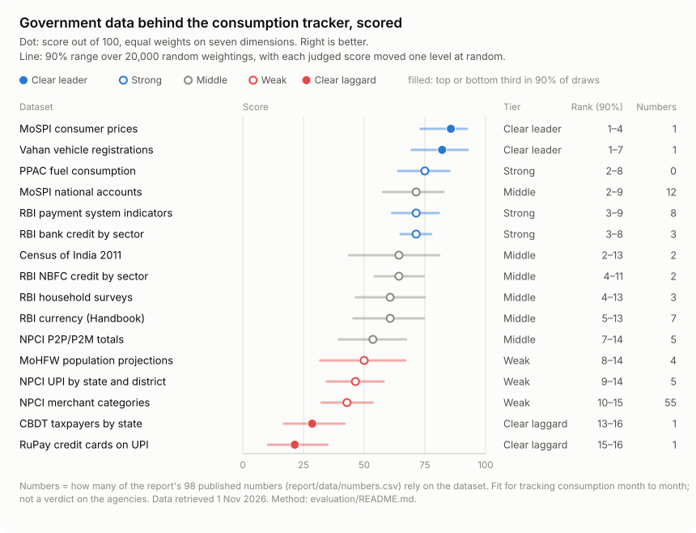

# Government data scorecard

How good is the official data this tracker runs on? This scores the 16 government and quasi-government datasets the report uses. Each is rated on seven dimensions, and every score cites its evidence. Datasets are ranked with a 90% range rather than a single place, because the order depends on how you weight the dimensions and on the scores that are judgement calls.



The full table is in [scorecard.md](scorecard.md). Every score and its evidence is in [scorecard_cells.csv](scorecard_cells.csv).

The question is **fitness for tracking consumption month to month**. It is not a verdict on the agencies, and it does not ask whether a number is true.

## What it finds

1. **The report relies most on one of its weakest sources.** 55 of the report's 98 published numbers come from NPCI's merchant-category table, which scores 43 out of 100 (Weak; in the bottom third in 88% of draws). On the "where to act first" measure below, better NPCI category data would help this report about nine times as much as the next fix.
2. **NPCI's totals are sound, but its breakdowns are getting worse.** UPI totals match RBI's Payment System Indicators within 1% in all 76 shared months. But NPCI's unnamed "Others" line grew from 15% of merchant value (2021) to 45% (latest 12 months). UPI value with no state attached grew from 14% (Apr 2023) to 39% (Sep 2026). As UPI grows, the share of it that can be analysed shrinks.
3. **Fast is not the same as good.** Vahan (daily, by RTO) and PPAC (6 days after the month) are the quickest, but both lose points on access and documentation. MoSPI's national accounts take 62 days, but they are the best documented and the only source here with a public API.
4. **The bottom two exist only because a member of parliament asked.** State-wise taxpayers (Lok Sabha) and RuPay credit cards on UPI (Rajya Sabha) are one-off PDF annexures. If a number matters enough to be asked about in Parliament, it should be published on a schedule.
5. **The top rank has the least evidence behind it.** CPI ranks first, but 5 of its 7 scores are judged, because this repo uses only its press release. Its range (73–92) reflects that.
6. **One of the top three fixes is ours, not the government's.** The report takes cash held by the public from RBI's annual Handbook, published 122 days after the year ends. RBI publishes the same series fortnightly in its Weekly Statistical Supplement.

## How it works

### Seven dimensions, five levels each

The dimensions follow the quality frameworks of the European Statistical System and the IMF's Data Quality Assessment Framework, so the criteria were not invented here. All five levels for each dimension are in [rubric.csv](rubric.csv).

| Dimension | Question | Level 4 | Level 0 |
|---|---|---|---|
| Timeliness | How soon after the period ends is it published? | 7 days or less | more than 400 days |
| Frequency | How often is it published? | daily or weekly | one-off or ad hoc |
| Detail | How finely does it break down by place and category? | district, with categories | one national total |
| Completeness | What share of the total is classified, with no gaps? | 95% or more | under 50% |
| Consistency | Can you compare it over time and with other sources? | 10+ years, breaks bridged | one-off |
| Access | Can a script get it reliably? | API or bulk download | not published |
| Documentation | Are methods, revisions and breaks explained? | calendar, revision labels, break notices | none |

### Every score has a basis

| Basis | Count | Meaning |
|---|---|---|
| measured | 18 | Computed from `data/` by `evaluate.py` (timeliness, and completeness where the data allow). Nobody types these in |
| documented | 55 | Follows from a fact the publisher states or this repo records: "monthly", "public API", "about 95 per cent of non-food credit" |
| judged | 39 | A reading of the evidence where the rubric is not decisive. These are the scores to challenge |

### Score, range, rank, tier

- **Score** = 25 × the average level, so it runs from 0 to 100, with equal weights on the seven dimensions.
- **90% range.** 20,000 draws. Each draw picks random weights (Dirichlet, α = 2 per dimension, so one dimension's weight ranges from near zero to about three times its equal share). It also moves each judged score up one level with probability ¼ and down one level with probability ¼. Measured and documented scores stay fixed. The range runs from the 5th to the 95th percentile of the draws, for the score and for the rank.
- **Tier**, from how often a dataset falls in the top or bottom third of the 16 (five places each) across the draws:

  | Tier | Rule |
  |---|---|
  | Clear leader | top third in at least 90% of draws |
  | Strong | top third in at least 50% |
  | Clear laggard | bottom third in at least 90% |
  | Weak | bottom third in at least 50% |
  | Middle | otherwise |

  Filled dots in the chart are the two "clear" tiers. A dataset can share a rank with another and still sit in a different tier, because tiers come from the whole range, not from the dot.
- **Numbers** counts the rows in `report/data/numbers.csv` whose source matches the dataset (`numbers_pattern` in `sources.csv`). **Where to act first** = numbers × (100 − score) ÷ 100.
- **Robustness.** Varying α from 1 to 5 and the judged-score nudge from 15% to 35% changes only three tiers: Vahan (Clear leader or Strong), MoSPI national accounts (Middle or Strong) and NPCI merchant categories (Weak or Clear laggard).

## Reproduce

```bash
python evaluation/evaluate.py            # data/ + evaluation/*.csv -> build/scorecard.*
python evaluation/evaluate.py --publish  # and copy the outputs into evaluation/
python -m pytest tests                   # rebuild check, score-table checks, evidence checks
```

The random draws use numpy's legacy `RandomState` with a fixed seed, which gives the same stream on every numpy version, so the published scorecard rebuilds exactly.

## Adding a dataset

The scorecard is also the gate for new data. Before the tracker uses a new government dataset:

1. Add a row to `sources.csv`. `numbers_pattern` is how `numbers.csv` will cite it; `latest_period_end` and `release_date` drive the measured timeliness.
2. Score each remaining dimension in `scores.csv`, with its basis and evidence. Better still, add a measurement to `evaluate.py`.
3. Run `python evaluation/evaluate.py --publish`. It stops if a score is missing, scored twice, out of range, or has no evidence. It also stops if `sources.csv` disagrees with the latest period in `data/`.

Candidates for the next edition: GST collections and e-way bills (GSTN), IIP, PLFS and HCES 2023-24 (MoSPI), EPFO payroll, and power demand (Grid-India).

## What it can't tell you

- **The agencies' overall quality.** It rates fitness for this tracker. A dataset built for another purpose, like the census, can be excellent and still score low here.
- **Revisions.** How far first estimates move later matters most for a tracker, and it is not scored yet, because there is only one vintage. Every edition commits `data/` to git, so git history is the vintage archive. The December 2026 edition will give the first measured revisions for NPCI, RBI PSI and MoSPI, and revisions become an eighth dimension then. Until it exists, the scorecard rewards releasing fast even when the early numbers are revised heavily later.
- **Precise places.** Sixteen datasets is a small field, so ranks move in steps and the ranges are wide. Read the tiers, not the rank.
- **Anyone else's weights.** Equal weights are a choice. Someone nowcasting would weight timeliness more; an academic would weight consistency more. The range shows how much the order depends on that choice.
- **More than one reader's judgement.** The 39 judged scores are one reading of the evidence. If you disagree, open an issue with evidence; the score changes in `scores.csv` and the chart rebuilds.

## Files

| File | What it is |
|---|---|
| `sources.csv` | The registry: one row per dataset, with publisher, access route, latest period, release date, how `numbers.csv` cites it, and the one change that would lift its score most |
| `rubric.csv` | Seven dimensions × five levels, with the framework each maps to |
| `scores.csv` | Documented and judged scores, each with its evidence |
| `evaluate.py` | Measures timeliness and completeness from `data/`, checks the table, runs the draws, writes the outputs |
| `scorecard.csv` | Results: score, range, rank, rank range, tier, dimension scores, numbers using each dataset |
| `scorecard_cells.csv` | All 112 dataset × dimension scores with basis and evidence |
| `scorecard.svg`, `scorecard.md` | The chart and the table (generated) |
